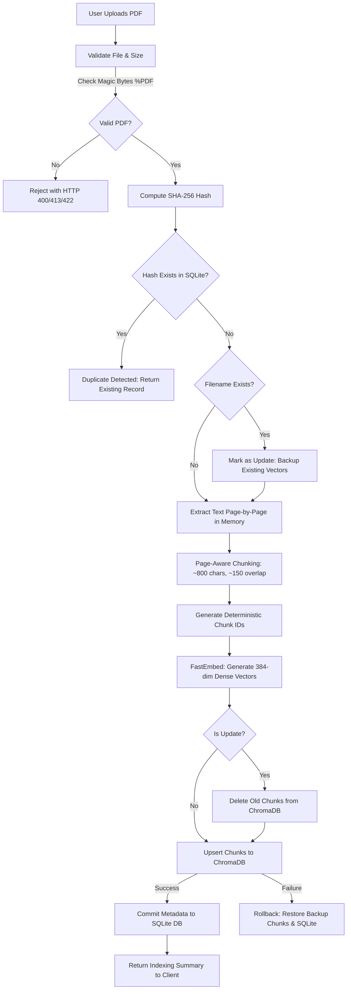

# Knowledge Assistant — RAG-Powered PDF Question Answering

[](https://fastapi.tiangolo.com)
[-000000.svg?style=flat&logo=next.js)](https://nextjs.org)
[](https://www.python.org)
[-FF6F00.svg?style=flat)](https://github.com/qdrant/fastembed)
[](https://www.trychroma.com)
[](https://ai.google.dev)
[](https://docs.pytest.org)

An end-to-end, production-grade **Retrieval-Augmented Generation (RAG)** platform designed to ingest, chunk, embed, index, and query PDF documents with verifiable source citations and streaming responses. 

The application pairs a high-performance **FastAPI** backend with a modern **Next.js 16** (React 19) App Router frontend. It employs local dense vector embeddings (`BAAI/bge-small-en-v1.5`), persistent **ChromaDB** storage, hybrid dense-lexical reranking, bounded exponential retries against **Google Gemini 2.5 Flash**, content-hash duplicate detection, and automated RAG evaluation.

---

## Table of Contents

- [1. Project Overview](#1-project-overview)
- [2. Key Features](#2-key-features)
- [3. AI Concepts Implemented](#3-ai-concepts-implemented)
- [4. RAG Architecture and Workflow](#4-rag-architecture-and-workflow)
- [5. Technology Stack](#5-technology-stack)
- [6. Architecture and Project Structure](#6-architecture-and-project-structure)
- [7. Prerequisites and Installation](#7-prerequisites-and-installation)
- [8. How to Use](#8-how-to-use)
- [9. API Overview](#9-api-overview)
- [10. Evaluation and Testing](#10-evaluation-and-testing)
- [11. Known Limitations](#11-known-limitations)
- [12. Security Considerations](#12-security-considerations)
- [13. Future Improvements](#13-future-improvements)
- [14. Learning Outcomes](#14-learning-outcomes)
- [15. License](#15-license)

---

## 1. Project Overview

### What the Application Does
Knowledge Assistant is an AI-powered document intelligence system. Users can upload arbitrary PDF documents (such as corporate handbooks, research papers, legal policies, or manuals), which the system extracts, chunks, vectorizes, and indexes. Users can then ask open-ended questions in natural language and receive grounded answers synthesized exclusively from the uploaded material, accompanied by precise page-level citations.

### The Problem It Solves
Standard Large Language Models (LLMs) suffer from three critical production failure modes:
1. **Hallucinations**: Generating confident, fluent answers that are factually incorrect or fabricated.
2. **Knowledge Cutoffs and Privacy Gaps**: Inability to access private, local, or up-to-date proprietary documents without retraining.
3. **Lack of Traceability**: Providing answers without verifiable source citations or evidence.

Knowledge Assistant solves these challenges by combining dense semantic vector search with prompt-grounded LLM inference:
- The system only provides answers supported by retrieved document excerpts.
- Every claim cites the exact source file and 1-based page number (e.g., `[Source: company_handbook.pdf, Page 3]`).
- When a query cannot be answered from the uploaded text, the model explicitly admits that the documents do not provide enough information rather than guessing.

### Main Capabilities
- **In-Memory PDF Extraction**: Fast, secure page-by-page text extraction without writing uploaded files to disk.
- **Page-Aware Boundary Chunking**: Splits text into ~800-character chunks with ~150-character overlaps, strictly preserving page boundaries.
- **Local Dense Embeddings**: Generates 384-dimensional dense semantic vectors using `BAAI/bge-small-en-v1.5` via FastEmbed, requiring zero external embedding API calls.
- **Persistent Vector Storage**: Stores chunk embeddings and metadata in ChromaDB with persistent disk backing and atomic update/rollback safety.
- **Hybrid Dense-Lexical Reranking**: Blends dense cosine similarity (65%) with inverse document frequency (BM25-style lexical matching, 35%) to prevent term dilution.
- **Resilient Hosted LLM Pipeline**: Queries Google Gemini 2.5 Flash using bounded retries, exponential backoff, and `Retry-After` header parsing.
- **Real-Time Token Streaming**: Server-Sent Events (SSE) streaming delivering instant responses with client-disconnect detection.
- **Lifecycle Document Management**: SHA-256 duplicate detection, atomic document replacement, and complete deletion across SQLite and ChromaDB.
- **Automated RAG Evaluation Suite**: Quantitative benchmarking measuring Recall@K, Mean Reciprocal Rank (MRR), Citation Correctness, Refusal Accuracy, and Fact Coverage.

---

## 2. Key Features

| Feature | Implementation Details |
| :--- | :--- |
| **PDF Upload & In-Memory Extraction** | Validates PDF magic bytes (`%PDF`), enforces file size limits (default 10 MB), checks for password encryption, and extracts text page-by-page using PyPDF purely in memory. |
| **Page-Aware Chunking** | Configurable chunk size (800 chars) and overlap (150 chars). Text from different pages is **never** merged across page boundaries. Splits at natural paragraph (`\n\n`), line (`\n`), sentence, or word boundaries. |
| **Deterministic Chunk IDs** | Chunks receive stable IDs matching `{clean_filename}_p{page_number}_c{chunk_index}`, guaranteeing reproducible lookups and clean upserts. |
| **Local Dense Embeddings** | Uses FastEmbed with `BAAI/bge-small-en-v1.5` (384 dimensions) for local execution without external embedding API costs or network latency. |
| **Persistent Vector Database** | ChromaDB persistent storage located at `backend/data/chroma`. Features automatic graceful fallback to a JSON-backed persistent store if ChromaDB is unavailable. |
| **Hybrid Retrieval & Reranking** | Retrieves an expanded candidate pool (`top_k * 3`) and linearly blends dense vector cosine similarity (65%) with lexical keyword matching (35%) to prioritize high-discrimination terms. |
| **Strictly Grounded RAG** | Assembles retrieved excerpts into structured prompts with negative constraints: answer strictly from context, cite sources, and admit missing information. |
| **Real-Time SSE Streaming** | Streams tokens via Server-Sent Events (`/api/conversations/{id}/messages/stream`) with immediate user message persistence and client disconnect detection (`request.is_disconnected()`). |
| **Source Citations** | Synthesizes answers containing inline citations citing the exact document and page number (e.g. `[Source: company_handbook.pdf, Page 4]`). |
| **Content-Hash Duplicate Detection** | Computes SHA-256 digests over uploaded bytes. Re-uploading an identical file skips re-extraction, re-embedding, and vector upserting, returning the existing indexed record. |
| **Atomic Document Updates** | Uploading an updated PDF with the same filename embeds new chunks first, backs up existing vectors, deletes stale chunks, upserts new chunks, and automatically rolls back if an error occurs. |
| **Document Deletion & Cleanup** | `DELETE /api/documents/{id}` removes SQLite records and vector store entries atomically, ensuring deleted content can no longer appear in search results or RAG answers. |
| **Fault-Tolerant Error Handling** | Handles Gemini 429 rate limits and 503 service outages with exponential backoff (up to 3 retries). Sanitizes API keys and secrets from logs and client error responses. |
| **Dual-Mode RAG Evaluation** | Script at `backend/scripts/evaluate_rag.py` supports both deterministic offline mock testing and live end-to-end evaluation with quantitative metrics. |

---

## 3. AI Concepts Implemented

The following table distinguishes AI and engineering concepts actively implemented in this codebase from related theoretical concepts:

```
┌────────────────────────────────────────────────────────────────────────┐
│                        AI Concepts in this Project                     │
├───────────────────────────────────┬────────────────────────────────────┤
│       Actively Implemented        │   Not Implemented / Related Only   │
├───────────────────────────────────┼────────────────────────────────────┤
│ • Retrieval-Augmented Generation  │ • Fine-tuning / Model Training     │
│ • Local Dense Vector Embeddings   │ • Reinforcement Learning (RLHF)    │
│ • Vector Similarity Search (ANN)  │ • Graph-based RAG (GraphRAG)       │
│ • Hybrid Reranking (Dense+Lexical)│ • Optical Character Recognition    │
│ • Prompt Grounding & Citations    │ • Cross-Encoder Neural Rerankers   │
│ • Bounded Retry / Rate-Limit Exp. │ • Agentic Tool-Calling Loops       │
│ • RAG Evaluation (Recall, MRR)    │ • Multi-modal Visual Embeddings    │
└───────────────────────────────────┴────────────────────────────────────┘
```

### Detailed Conceptual Breakdown

#### 1. Artificial Intelligence, Machine Learning & LLMs
- **Concept**: Artificial Intelligence encompasses computer systems performing tasks that traditionally require human cognition. Machine Learning models learn statistical representations from training data. Large Language Models (LLMs) are deep neural networks (typically Transformers) trained on massive text corpora to predict next tokens in a sequence.
- **In This Project**: The project **does not train or fine-tune its own LLM**. It uses Google's hosted, pretrained `gemini-2.5-flash` foundation model via official API endpoints (`google-genai` SDK) strictly for inference, prompt-guided synthesis, and summarization.

#### 2. Generative AI
- **Concept**: Generative AI refers to algorithms capable of generating novel content (text, audio, imagery) based on learned probabilistic distributions and input context.
- **In This Project**: Used to generate fluent, context-grounded textual answers to arbitrary user questions based on retrieved knowledge snippets.

#### 3. Retrieval-Augmented Generation (RAG)
- **Concept**: RAG is an architectural pattern that bridges static LLM weights with external dynamic knowledge. Instead of expecting the LLM to recall facts from its training parameters, relevant passages are dynamically retrieved from an indexed knowledge store and injected into the prompt as reference material.
- **In This Project**: Fully implemented end-to-end: PDF text is indexed into ChromaDB; incoming user queries trigger semantic vector retrieval; retrieved chunks populate a structured context block; Gemini generates an answer grounded strictly within that context.

#### 4. Document Ingestion and Preprocessing
- **Concept**: The extraction, sanitization, and normalization of raw unstructured documents into structured, parseable text representations.
- **In This Project**: `PDFService` validates PDF headers (`%PDF`), strips unsafe path characters, detects password encryption, and extracts clean unicode text on a per-page basis strictly in memory.

#### 5. Text Chunking and Chunk Metadata
- **Concept**: Dividing long documents into smaller textual segments suitable for embedding models and LLM context windows. Preserving contextual metadata (source file, page, offset) is essential for traceability.
- **In This Project**: `ChunkingService` enforces a target chunk size of ~800 characters with a 150-character sliding overlap. It strictly isolates page boundaries (never merging across pages), searches for natural semantic split boundaries (`\n\n`, `\n`, sentence punctuation, spaces), and attaches source filename, page number, and stable IDs to each chunk.

#### 6. Text Embeddings and Semantic Similarity
- **Concept**: Embedding models map arbitrary text strings into continuous, high-dimensional vector spaces ($\mathbb{R}^d$) such that texts with similar semantic meanings reside close to each other, as measured by mathematical distance (e.g., Cosine Similarity or Euclidean Distance).
- **In This Project**: Uses FastEmbed running `BAAI/bge-small-en-v1.5` locally to generate 384-dimensional dense float vectors. Query embeddings and chunk embeddings are compared using cosine similarity ($1 - \text{cosine\_distance}$).

#### 7. Vector Databases and Similarity Search
- **Concept**: Specialized databases optimized to index, store, and query millions of high-dimensional vectors efficiently using Approximate Nearest Neighbor (ANN) or exact k-Nearest Neighbor (k-NN) algorithms.
- **In This Project**: ChromaDB (`ChromaVectorStore`) stores chunk embeddings alongside chunk text, filename, and page number in a persistent directory (`backend/data/chroma`). An in-memory vector store (`InMemoryVectorStore`) is also implemented for lightweight testing.

#### 8. Hybrid Retrieval and Reranking
- **Concept**: Dense vector search excels at conceptual matching but can miss exact keyword matches, technical codes, or proper nouns. Hybrid retrieval combines dense semantic vector search with sparse lexical scoring (such as BM25) to achieve the best of both worlds.
- **In This Project**: `SearchService._apply_hybrid_reranking` retrieves `top_k * 3` candidate chunks using dense cosine similarity, computes an inverse document frequency (IDF) weighted lexical score for discriminative query terms, and linearly blends them:
  $$\text{Score}_{\text{hybrid}} = 0.65 \times \text{Similarity}_{\text{dense}} + 0.35 \times \text{Score}_{\text{lexical}}$$

#### 9. Prompt Engineering and Context Augmentation
- **Concept**: The strategic design of system instructions, constraints, and injected context to guide the LLM's outputs toward desired behaviors and formatting rules.
- **In This Project**: `RAGService.format_rag_prompt` organizes retrieved chunks into delineated `[Source X: filename | Page Y | Chunk ID: Z]` blocks and applies strict grounding guardrails.

#### 10. Grounded Generation and Hallucination Reduction
- **Concept**: Constraining the model to generate responses derived *solely* from supplied context passages, instructing it to refuse to answer if information is absent.
- **In This Project**: The prompt enforces negative constraints: *"If the provided context does NOT contain enough information to answer the question, clearly state: 'The uploaded documents do not provide enough information to answer this question.' Do NOT attempt to guess, extrapolate, or fabricate any information or citations."*

#### 11. Source Citations and Traceability
- **Concept**: Requiring the generative model to explicitly reference the specific source document and page number for every factual claim it makes.
- **In This Project**: System prompts instruct the LLM to tag every fact with `[Source: filename.pdf, Page X]`. The evaluation harness inspects output answers to verify that cited page numbers match the actual source pages.

#### 12. Streaming LLM Responses
- **Concept**: Progressively sending text tokens to the client over an open HTTP connection as they are generated by the model, minimizing perceived time-to-first-token (TTFT).
- **In This Project**: `POST /api/conversations/{id}/messages/stream` uses FastAPI's `StreamingResponse` to deliver Server-Sent Events (SSE) events (`user_message`, `chunk`, `complete`, `error`), with active client-disconnect checks.

#### 13. RAG Evaluation and Retrieval Metrics
- **Concept**: Measuring the quantitative performance of both retrieval (did we find the right documents?) and generation (did the model answer accurately with correct citations?).
- **In This Project**: Implemented in `backend/scripts/evaluate_rag.py`:
  - **Recall@K**: Whether an expected relevant page was retrieved within the top-K chunks.
  - **Mean Reciprocal Rank (MRR)**: $1 / \text{rank}$ of the first relevant retrieved page.
  - **Citation Correctness**: Whether the model's citations point to valid ground-truth pages.
  - **Refusal Accuracy**: Whether unanswerable questions were correctly declined without hallucinations.
  - **Normalized Fact Coverage**: Lexical token and phrase verification comparing model answers against ground-truth fact checklists.

#### 14. API Integration with an LLM Provider
- **Concept**: Communicating over secure HTTPS with an external hosted foundation model provider using their official SDK, handling authentication, request serialization, and response parsing.
- **In This Project**: Interfaces with Google Gemini using the new `google-genai` SDK (`genai.Client(api_key=...)`).

#### 15. Retry Handling, Rate Limits & Failure Recovery
- **Concept**: Building resilient distributed integrations that withstand transient HTTP 429 (Rate Limit / Quota Exceeded) and 503 (Service Unavailable) errors using exponential backoff and jitter.
- **In This Project**: `GeminiProvider` implements a bounded retry loop (up to 3 retries) with exponential backoff ($delay = initial \times 2^{attempt}$), parses `Retry-After` headers, distinguishes transient from permanent errors (e.g., 401 Auth errors fail immediately), and sanitizes credentials from log outputs.

#### 16. Unit Testing and Integration Testing
- **Concept**: Validating software correctness at multiple levels of granularity: isolated unit tests for individual functions and end-to-end integration tests for multi-component workflows.
- **In This Project**: 6 comprehensive Pytest suites verify PDF chunking, document upload/deletion lifecycles, vector storage, RAG prompt construction, streaming mechanics, and evaluation metrics using deterministic offline mocks.

---

## 4. RAG Architecture and Workflow

The RAG system operates in two distinct phases: **Ingestion & Indexing** and **Query & Question Answering**.

### Ingestion and Indexing Flow

When a user uploads a PDF, the document passes through validation, extraction, chunking, embedding, vector storage, and relational tracking:



### Retrieval and Question Answering Flow

When a user submits a natural-language question, the system retrieves relevant chunks, applies hybrid reranking, constructs a grounded prompt, and streams the answer from Gemini:

```mermaid
flowchart TD
    A1[User Submits Question] --> B1[FastEmbed: Embed Query into 384-dim Vector]
    B1 --> C1[ChromaDB: Retrieve Candidate Chunks (top_k * 3)]
    
    C1 --> D1[Hybrid Reranker: 65% Dense Similarity + 35% Lexical IDF Overlap]
    D1 --> E1[Select Top-K Ranked Chunks]
    
    E1 --> F1[Format Grounded Prompt with Citations & Context]
    F1 --> G1[Google Gemini 2.5 Flash]
    
    G1 --> H1{API Error?}
    H1 -->|429 Rate Limit / 503 Outage| I1{Retries < 3?}
    I1 -->|Yes| J1[Exponential Backoff / Sleep Retry-After]
    J1 --> G1
    I1 -->|No| K1[Sanitize Error & Return HTTP 502/429]
    
    H1 -->|Success| L1[Stream Tokens via Server-Sent Events]
    L1 --> M1{Client Disconnected?}
    M1 -->|Yes| N1[Abort Stream Cleanly]
    M1 -->|No| O1[Persist Assistant Message with Citations in SQLite]
    O1 --> P1[Render Message & Citations in UI]
```

---

## 5. Technology Stack

All technology choices reflect the actual dependencies configured in `backend/requirements.txt` and `frontend/package.json`:

### Backend
- **Framework**: [FastAPI](https://fastapi.tiangolo.com) (`>=0.115.0`) — Asynchronous REST API, dependency injection, and SSE streaming.
- **ASGI Server**: [Uvicorn](https://www.uvicorn.org) (`>=0.30.0`) — Lightning-fast ASGI web server implementation.
- **Data Validation & Settings**: [Pydantic v2](https://docs.pydantic.dev) (`>=2.9.0`) & [Pydantic-Settings](https://docs.pydantic.dev/latest/concepts/pydantic_settings/) (`>=2.4.0`).
- **Database & ORM**: [SQLAlchemy](https://www.sqlalchemy.org) (`>=2.0.30`) with SQLite (`backend/data/chat.db`).
- **PDF Extraction**: [PyPDF](https://pypdf.readthedocs.io) (`>=4.0.0`) — In-memory stream parsing and page extraction.
- **Embeddings**: [FastEmbed](https://github.com/qdrant/fastembed) (`>=0.4.0`) — Local ONNX-based dense semantic embedding runtime.
  - **Default Embedding Model**: `BAAI/bge-small-en-v1.5` (384 dimensions).
- **Vector Database**: [ChromaDB](https://www.trychroma.com) (`>=0.5.0`) — Embedded persistent vector store with cosine distance index.
- **LLM Provider**: [Google GenAI SDK](https://github.com/googleapis/python-genai) (`google-genai>=0.1.1`).
  - **Default LLM**: `gemini-2.5-flash`.
- **HTTP Client**: [HTTPX](https://www.python-httpx.org) (`>=0.27.0`) — Asynchronous HTTP testing and API calls.
- **Testing**: [Pytest](https://docs.pytest.org) (`>=8.0.0`) and [pytest-asyncio](https://pytest-asyncio.readthedocs.io) (`>=0.23.0`).

### Frontend
- **Framework**: [Next.js 16.4.2](https://nextjs.org) (App Router architecture).
- **UI Library**: [React 19.3.0](https://react.dev) & React DOM 19.3.0.
- **Styling**: [Tailwind CSS v4](https://tailwindcss.com) (`@tailwindcss/turbopack`).
- **Language**: [TypeScript 5](https://www.typescriptlang.org).
- **Linting**: [ESLint 9](https://eslint.org) with `eslint-config-next`.

---

## 6. Architecture and Project Structure

### Repository Directory Tree

```
knowledge_assistant/
├── README.md                           # Comprehensive project documentation
├── AGENTS.md                           # Autonomous execution & agent rules
├── .gitignore                          # Git ignore rules for Python & Node.js
│
├── backend/
│   ├── main.py                         # FastAPI application entrypoint & CORS config
│   ├── requirements.txt                # Python backend dependencies
│   ├── pytest.ini                      # Pytest configuration & async modes
│   ├── .env                            # Local environment configuration (API keys)
│   │
│   ├── app/
│   │   ├── config.py                   # Pydantic BaseSettings (model, chunk size, store)
│   │   ├── db/
│   │   │   ├── models.py               # SQLAlchemy models: UploadedDocument, Conversation, Message
│   │   │   └── session.py              # SQLite engine, sessionmaker, and get_db dependency
│   │   ├── providers/
│   │   │   ├── base.py                 # Abstract AIProvider interface
│   │   │   ├── gemini.py               # GeminiProvider with bounded exponential retries & sanitization
│   │   │   └── embeddings/
│   │   │       └── mock_provider.py    # Deterministic MockEmbeddingProvider for offline tests
│   │   ├── routes/
│   │   │   ├── conversations.py        # Conversation CRUD, message history, & SSE streaming
│   │   │   └── documents.py            # PDF upload, chunking, indexing, search, ask, deletion
│   │   ├── schemas/
│   │   │   ├── chat.py                 # Pydantic schemas for chat sessions and streaming events
│   │   │   ├── document.py             # Schemas for PDF extraction, chunks, and metadata
│   │   │   └── search.py               # Schemas for vector queries, top-k results, and RAG QA
│   │   ├── services/
│   │   │   ├── ai_service.py           # Provider delegation for general LLM completions
│   │   │   ├── chat_history_service.py # SQLite database persistence for messages and sessions
│   │   │   ├── chunking_service.py     # Page-isolated chunking with natural boundary heuristics
│   │   │   ├── embedding_service.py    # FastEmbed dense embedding generation and batching
│   │   │   ├── pdf_service.py          # PyPDF byte inspection, header validation, and page parsing
│   │   │   ├── rag_service.py          # Grounded prompt construction, citation rules, and QA logic
│   │   │   └── search_service.py       # Vector indexing, hybrid dense-lexical reranking, atomic updates
│   │   └── vector_store/
│   │       ├── base.py                 # Abstract BaseVectorStore interface
│   │       ├── chroma_store.py         # ChromaDB persistent collection adapter
│   │       ├── factory.py              # Singleton factory with Chroma -> Memory fallback
│   │       └── memory_store.py         # In-memory vector store with optional JSON persistence
│   │
│   ├── data/
│   │   ├── chat.db                     # SQLite database storing conversations and documents
│   │   ├── chroma/                     # ChromaDB persistent vector storage directory
│   │   ├── eval_dataset.json           # 20-question evaluation dataset with ground-truth facts
│   │   ├── eval_results.json           # Output metrics and per-query diagnostics from evaluate_rag.py
│   │   └── sample_documents/           # Test documents (e.g., generated company_handbook.pdf)
│   │
│   ├── scripts/
│   │   ├── evaluate_rag.py             # Evaluation harness (Recall, MRR, Citations, Refusal, Facts)
│   │   └── generate_sample_pdf.py      # Generates synthetic multi-page company handbook PDF
│   │
│   └── tests/
│       ├── test_chunking.py            # Unit tests for chunk size, overlap, and page isolation
│       ├── test_documents.py           # Tests for upload, duplicate detection, updates, and deletion
│       ├── test_embeddings.py          # Tests for embedding generation and vector dimensionality
│       ├── test_evaluation.py          # Tests for the RAG evaluation metrics and scoring math
│       ├── test_rag.py                 # Tests for prompt formatting, citations, retries, and streaming
│       └── test_vector_store.py        # Tests for ChromaDB and InMemoryVectorStore operations
│
└── frontend/
    ├── package.json                    # Next.js 16, React 19, Tailwind CSS dependencies
    ├── tsconfig.json                   # TypeScript configuration
    ├── next.config.ts                  # Next.js runtime configuration
    ├── .env.local.example              # Example frontend environment variables
    │
    └── src/
        ├── app/
        │   ├── layout.tsx              # Root HTML layout and global styles
        │   ├── page.tsx                # Home page (renders chat interface)
        │   ├── documents/
        │   │   └── page.tsx            # Documents page (upload zone and document list)
        │   └── globals.css             # Tailwind CSS tokens and base styles
        ├── components/
        │   └── ui/                     # Reusable UI components (Button, Input, Badge, Dialog)
        ├── features/
        │   ├── chat/
        │   │   ├── components/         # ChatInterface, ChatMessage, ChatInput, ChatSidebar
        │   │   ├── hooks/              # useChatStream (SSE parser) and useConversations
        │   │   └── types/              # Chat message and session TypeScript interfaces
        │   └── documents/
        │       ├── components/         # DocumentUploadPage, UploadZone, DocumentList
        │       ├── hooks/              # useDocumentUpload and useDocumentManagement
        │       ├── services/           # document-api client for FastAPI communication
        │       └── types/              # Document and chunk TypeScript interfaces
        └── lib/
            └── utils.ts                # Tailwind clsx/twMerge utilities and date formatters
```

---

## 7. Prerequisites and Installation

### Prerequisites
- **Python**: Version `3.10` or higher (verified with Python 3.10 - 3.12).
- **Node.js**: Version `18.17` or higher (Node `20.x` LTS recommended).
- **Package Managers**: `pip` (Python) and `npm` (Node.js).
- **Google Gemini API Key**: Obtain a free API key from [Google AI Studio](https://aistudio.google.com/).

---

### Step 1: Clone or Navigate to the Repository

```bash
cd F:\Python\knowledge_assistant
```

---

### Step 2: Backend Setup

1. **Create and activate a Python virtual environment** (Windows PowerShell / Command Prompt):

   *Windows PowerShell:*
   ```powershell
   cd backend
   python -m venv .venv
   .\.venv\Scripts\Activate.ps1
   ```

   *Windows Command Prompt (cmd):*
   ```cmd
   cd backend
   python -m venv .venv
   .\.venv\Scripts\activate.bat
   ```

   *Linux / macOS:*
   ```bash
   cd backend
   python3 -m venv .venv
   source .venv/bin/activate
   ```

2. **Install backend dependencies**:
   ```bash
   pip install --upgrade pip
   pip install -r requirements.txt
   ```

3. **Configure environment variables**:
   Create a `.env` file in the `backend/` directory:

   ```bash
   # In backend/.env
   AI_PROVIDER=gemini
   GEMINI_API_KEY=your_gemini_api_key_here
   GEMINI_MODEL=gemini-2.5-flash
   ```

   *Configuration Options in `backend/app/config.py`:*
   - `GEMINI_API_KEY`: Your Google GenAI API key.
   - `GEMINI_MODEL`: Default model name (`gemini-2.5-flash` or `gemini-1.5-pro`).
   - `CHUNK_SIZE`: Target characters per chunk (default: `800`).
   - `CHUNK_OVERLAP`: Overlap characters between chunks on the same page (default: `150`).
   - `EMBEDDING_PROVIDER`: `local` (uses FastEmbed) or `mock`.
   - `EMBEDDING_MODEL`: Compact semantic embedding model (default: `BAAI/bge-small-en-v1.5`).
   - `VECTOR_STORE_TYPE`: `chroma` (default) or `memory`.
   - `CHROMA_PERSIST_DIRECTORY`: Path for vector persistence (default: `backend/data/chroma`).
   - `SEARCH_TOP_K`: Default chunks retrieved per query (default: `4`).
   - `MAX_UPLOAD_SIZE_BYTES`: Max PDF upload size (default: `10485760` = 10 MB).

---

### Step 3: Frontend Setup

1. Open a new terminal window and navigate to `frontend`:
   ```bash
   cd F:\Python\knowledge_assistant\frontend
   ```

2. **Install Node.js dependencies**:
   ```bash
   npm install
   ```

3. **Configure frontend environment variables**:
   Create a `.env.local` file based on `.env.local.example`:
   ```bash
   # In frontend/.env.local
   NEXT_PUBLIC_API_BASE_URL=http://127.0.0.1:8000
   ```

---

### Step 4: Running the Application

1. **Start the FastAPI Backend** (from `backend/` with virtual environment active):
   ```bash
   uvicorn main:app --reload --host 127.0.0.1 --port 8000
   ```
   *The backend will be available at:* `http://127.0.0.1:8000` (API documentation at `/docs`).

2. **Start the Next.js Frontend** (from `frontend/`):
   ```bash
   npm run dev
   ```
   *The web UI will be available at:* `http://localhost:3000`.

---

## 8. How to Use

### 1. Uploading Documents
1. Navigate to `http://localhost:3000/documents` using your browser.
2. Drag and drop any standard PDF document (up to 10 MB) into the upload zone, or click to browse.
3. The system will process the file in memory:
   - Verifies PDF magic bytes (`%PDF`).
   - Computes a SHA-256 content hash.
   - Extracts text page-by-page.
   - Splits text into page-isolated chunks.
   - Computes 384-dimensional dense vectors using FastEmbed.
   - Stores the vectors in ChromaDB and records metadata in SQLite.
4. The extraction summary will display the detected page count, character count, chunk count, and indexing status.

### 2. Handling Duplicate and Updated Documents
- **Duplicate Upload**: If you re-upload an identical document with the same content hash, the system displays an alert indicating that identical content is already indexed, skipping redundant embedding and indexing.
- **Updated Document**: If you upload a modified PDF with the **same filename**, the system embeds the new chunks, atomically removes the old chunks from ChromaDB, and inserts the new version. If any error occurs, the previous version is automatically restored.

### 3. Asking Grounded Questions
1. Return to the Chat interface at `http://localhost:3000`.
2. Ensure the **RAG toggle** is enabled (or use the default RAG mode).
3. Type a question related to your uploaded documents (e.g., *"What is the policy for parental leave?"* or *"When was the company founded?"*).
4. The assistant streams the answer in real time using Server-Sent Events.

### 4. Understanding Citations
Every grounded answer references its source passages:
- In-text citations appear as `[Source: company_handbook.pdf, Page 4]`.
- If a question cannot be answered from the uploaded material, the assistant explicitly replies:
  > *"The uploaded documents do not provide enough information to answer this question."*

### 5. Managing Documents
1. Visit `http://localhost:3000/documents` and scroll down to the **Knowledge Base Documents** section.
2. View all indexed files along with their page count, chunk count, and upload timestamp.
3. To delete a document, click **Delete**, confirm the prompt, and the document is removed simultaneously from SQLite and ChromaDB. Subsequent questions will no longer retrieve chunks from that document.

---

## 9. API Overview

The FastAPI backend exposes interactive OpenAPI documentation at `http://127.0.0.1:8000/docs`.

### Document Endpoints (`/api/documents`)

| Method | Endpoint | Description |
| :--- | :--- | :--- |
| `POST` | `/api/documents/upload` | Uploads a PDF, extracts text, chunks it, generates embeddings, and indexes chunks (default: `index=True`). Detects duplicates via SHA-256. |
| `POST` | `/api/documents/index` | Dedicated indexing endpoint: extracts, embeds, and stores chunks into ChromaDB. |
| `POST` | `/api/documents/index-chunks` | Directly indexes an existing array of `DocumentChunk` objects into the vector store. |
| `POST` | `/api/documents/chunk-preview` | Previews chunking behavior for arbitrary text without uploading a file. |
| `POST` | `/api/documents/embed-preview` | Generates a single embedding for arbitrary text to inspect model name and dimensionality. |
| `POST` | `/api/documents/embed-chunks` | Batch generates embeddings for a list of `DocumentChunk` objects. |
| `POST` | `/api/documents/search` | Performs hybrid semantic search (dense + lexical) for a query string. |
| `GET` | `/api/documents/search` | Browser-friendly GET endpoint for semantic search (`?q=query&top_k=4`). |
| `POST` | `/api/documents/ask` | Non-streaming RAG QA: retrieves chunks, prompts Gemini, returns answer and source chunks. |
| `GET` | `/api/documents` | Lists all uploaded documents recorded in the SQLite database with indexing stats. |
| `GET` | `/api/documents/{id}` | Retrieves metadata for a single document by its UUID. |
| `DELETE` | `/api/documents/{id}` | Atomically deletes a document from SQLite and removes its chunks from ChromaDB. |
| `GET` | `/api/documents/collection-stats` | Returns vector store statistics (total indexed chunks, active store backend). |
| `DELETE` | `/api/documents/collection` | Clears all vectors from ChromaDB and wipes document tracking records. |

### Conversation & Chat Endpoints (`/api/conversations`)

| Method | Endpoint | Description |
| :--- | :--- | :--- |
| `POST` | `/api/conversations` | Creates a new conversation session. |
| `GET` | `/api/conversations` | Lists all conversations ordered by recent activity. |
| `GET` | `/api/conversations/{id}` | Gets conversation metadata. |
| `PATCH` | `/api/conversations/{id}` | Renames a conversation title. |
| `DELETE` | `/api/conversations/{id}` | Deletes a conversation and all its messages. |
| `GET` | `/api/conversations/{id}/messages` | Retrieves chronological message history for a conversation. |
| `POST` | `/api/conversations/{id}/messages` | Non-streaming message endpoint (supports `?use_rag=true`). |
| `POST` | `/api/conversations/{id}/messages/stream` | **Streaming endpoint**: Progressively yields tokens via Server-Sent Events (SSE). |

---

### Request & Response Examples

#### 1. Upload & Index a PDF
```http
POST /api/documents/upload?index=true HTTP/1.1
Content-Type: multipart/form-data; boundary=----WebKitFormBoundary

------WebKitFormBoundary
Content-Disposition: form-data; name="file"; filename="handbook.pdf"
Content-Type: application/pdf

<PDF binary bytes>
------WebKitFormBoundary--
```

*Response (`200 OK`):*
```json
{
  "id": "e8a93144-8cb3-490f-90e9-b5f7e7591c2a",
  "filename": "handbook.pdf",
  "total_pages": 5,
  "total_characters": 8420,
  "has_extractable_text": true,
  "total_chunks": 14,
  "indexed_chunks": 14,
  "is_duplicate": false,
  "is_updated": false,
  "content_hash": "a591a6d40bf420404a011733cfb7b190d62c65bf0bcda32b57b277d9ad9f146e",
  "message": "Successfully extracted text from 5 page(s) (8420 characters, 14 chunks) and indexed 14 chunk(s) into the knowledge base."
}
```

#### 2. Semantic Search
```http
POST /api/documents/search HTTP/1.1
Content-Type: application/json

{
  "query": "core collaboration hours",
  "top_k": 2
}
```

*Response (`200 OK`):*
```json
{
  "query": "core collaboration hours",
  "total_results": 2,
  "model": "BAAI/bge-small-en-v1.5",
  "results": [
    {
      "chunk_id": "handbook_pdf_p2_c1",
      "text": "Core collaboration hours are 10:00 AM to 3:00 PM PST. All team members are expected to be available on Slack and Zoom during these hours.",
      "filename": "handbook.pdf",
      "page_number": 2,
      "chunk_index": 1,
      "similarity_score": 0.8421,
      "distance": 0.1579
    }
  ]
}
```

#### 3. Ask Question (RAG Endpoint)
```http
POST /api/documents/ask HTTP/1.1
Content-Type: application/json

{
  "question": "What are the core collaboration hours?",
  "top_k": 3
}
```

*Response (`200 OK`):*
```json
{
  "question": "What are the core collaboration hours?",
  "answer": "Core collaboration hours are 10:00 AM to 3:00 PM PST [Source: handbook.pdf, Page 2]. Team members are expected to be available for meetings and communications during this window.",
  "sources": [
    {
      "chunk_id": "handbook_pdf_p2_c1",
      "text": "Core collaboration hours are 10:00 AM to 3:00 PM PST...",
      "filename": "handbook.pdf",
      "page_number": 2,
      "chunk_index": 1,
      "similarity_score": 0.8421,
      "distance": 0.1579
    }
  ]
}
```

---

## 10. Evaluation and Testing

### The Evaluation Dataset
The repository includes a curated evaluation dataset at `backend/data/eval_dataset.json` comprising 20 challenging questions paired with a multi-page synthetic company handbook (`company_handbook.pdf`):
- **Direct Single-Page Questions (10)**: Factual questions targeting a specific detail on a single page (e.g. founding year, 401(k) match, stipend amount).
- **Multi-Section Questions (5)**: Inquiries that span multiple policies or comparative clauses across different pages (e.g. sick leave vs. vacation rollover).
- **Unanswerable Questions (5)**: Queries regarding topics not covered in the handbook (e.g. pet insurance, cafeteria menus, executive compensation) designed to test hallucination resistance.

### Evaluation Metrics Defined
The evaluation harness (`backend/scripts/evaluate_rag.py`) computes five quantitative metrics:

1. **Recall@K (%)**: The percentage of answerable questions for which at least one ground-truth page was successfully retrieved within the top-K chunks.
2. **Mean Reciprocal Rank (MRR)**: Evaluates ranking position quality ($1 / \text{rank}$ of the first relevant chunk). Chunks appearing at rank #1 receive 1.0; rank #2 receives 0.5.
3. **Citation Correctness (%)**: The percentage of answers containing valid citations where all cited page numbers match the actual ground-truth pages.
4. **Refusal Accuracy (%)**: The accuracy with which the system correctly detects unanswerable questions, clearly stating that the documents do not provide enough information without hallucinating facts or page citations.
5. **Fact Coverage (%)**: A normalized lexical verification algorithm that checks whether key constituent facts, percentages, currency values, and clauses from the ground-truth checklist appear in the generated answer.

---

### Running the Tests and Evaluation Suite

#### 1. Backend Pytest Suite (Mocked & Fast)
Runs 6 test suites verifying chunking, uploads, vector store, retries, and evaluation logic without calling live external APIs:

```powershell
cd backend
python -m pytest tests/ -v
```

To run a specific test suite:
```powershell
python -m pytest tests/test_rag.py -v
python -m pytest tests/test_documents.py -v
```

#### 2. Deterministic Offline RAG Evaluation
Evaluates the retrieval pipeline, ranking, and scoring logic using a deterministic mock LLM (requires no Gemini API key):

```powershell
cd backend
python scripts/evaluate_rag.py --top-k 4 --diagnostics
```

#### 3. Real-Pipeline Live Gemini Evaluation
Evaluates the real end-to-end pipeline using live **Google Gemini 2.5 Flash**, persistent **ChromaDB**, and local **FastEmbed** embeddings (requires a valid `GEMINI_API_KEY` in `backend/.env`):

```powershell
cd backend
python scripts/evaluate_rag.py --real-pipeline --top-k 4
```

*Subset Filtering Options for Low Quotas:*
```powershell
# Evaluate only a 3-question sample
python scripts/evaluate_rag.py --real-pipeline --limit 3

# Evaluate only unanswerable questions to test refusal accuracy
python scripts/evaluate_rag.py --real-pipeline --category unanswerable

# Evaluate specific question IDs
python scripts/evaluate_rag.py --real-pipeline --question-ids q01,q05,q16
```

> **Note on Evaluation Results**: Unit tests run against deterministic offline mocks to guarantee repeatable CI/CD test passes. Live evaluation scores depend on your active Gemini API quota and network connectivity. Results are written directly to `backend/data/eval_results.json`.

---

## 11. Known Limitations

1. **Hosted Model Rate Limits (HTTP 429)**: The Google Gemini free-tier imposes limits on Requests Per Minute (RPM) and Tokens Per Minute (TPM). While the system retries with exponential backoff, running large batch evaluations without delays may exhaust your quota.
2. **Text-Only PDF Extraction**: Text extraction relies on PyPDF. Scanned PDFs containing raster images without an embedded text layer will produce zero extractable characters. Optical Character Recognition (OCR) is not currently implemented.
3. **Single-Node Storage**: SQLite and local ChromaDB operate as embedded single-process files on local storage. They are not designed for distributed, multi-instance horizontal scaling.
4. **Context Window vs. Cost Trade-off**: Increasing `SEARCH_TOP_K` provides more context to the LLM but increases token consumption, latency, and potential attention dilution.
5. **Complex Table Parsing**: PyPDF extracts text in reading-stream order. Tables with complex multi-column structures or nested cells may experience column interleaving.

---

## 12. Security Considerations

### Implemented Protections
- **API Key Scrubbing**: API keys are loaded via environment variables (`.env`) and never exposed to the frontend. The `sanitize_log_message` utility strips Google AI Studio keys (`AIza...`) from application logs using regex patterns.
- **In-Memory File Validation**: Uploaded PDF bytes are inspected in memory. The system verifies `%PDF` magic bytes and rejects unauthorized extensions before processing.
- **Upload Size Bounds**: Uploads exceeding `MAX_UPLOAD_SIZE_BYTES` (10 MB default) are rejected with HTTP 413 before consuming memory.
- **Path Traversal Sanitization**: User-supplied filenames are sanitized using `os.path.basename` and stripped of illegal characters to prevent directory traversal attacks.
- **Sanitized Error Responses**: Internal tracebacks, database queries, and raw external exception messages are caught and converted into user-friendly domain errors (HTTP 400, 404, 429, 502, 503).
- **Client Disconnect Handling**: Streaming generators verify `await request.is_disconnected()` between tokens, avoiding orphaned generation tasks when users close their browser.

### Recommended Future Work for Production
- **User Authentication & Authorization**: Add JWT or OAuth2 authentication to isolate document collections between different users or tenants.
- **Prompt Injection Defense**: Incorporate a dedicated prompt guard model or heuristic checker (e.g., Llama Guard or NeMo Guardrails) to detect adversarial attempts to bypass grounding rules.
- **Antivirus Scanning**: Integrate ClamAV scanning for uploaded binary files in high-security environments.
- **Distributed Rate Limiting**: Implement Redis-backed token bucket rate limiters to protect public API routes from denial-of-service attempts.

---

## 13. Future Improvements

- **OCR Integration**: Integrate Tesseract OCR or AWS Textract to enable text extraction from scanned and photographed PDF documents.
- **Advanced Chunking Strategies**: Implement semantic chunking based on embedding similarity drops or layout-aware markdown chunking.
- **Cross-Encoder Reranking**: Deploy a neural cross-encoder model (such as `bge-reranker-large`) after initial bi-encoder retrieval to boost Precision@1.
- **Multi-Modal Document QA**: Ingest document images, charts, and diagrams using Gemini's native multimodal vision capabilities.
- **Multi-Tenant Distributed Vector Stores**: Support external enterprise vector databases such as Qdrant, Milvus, or pgvector.
- **Query Rewriting & HyDE**: Implement Hypothetical Document Embeddings (HyDE) and query expansion to improve recall on vague questions.

---

## 14. Learning Outcomes

This project demonstrates practical competence in foundational and advanced AI engineering disciplines:

1. **RAG Architecture & Pipeline Design**: Designing a complete retrieval-augmented generation lifecycle from raw binary ingestion to token streaming.
2. **Vector Space Fundamentals**: Understanding embedding spaces, dimensionality, cosine distance calculations, and candidate retrieval.
3. **Chunking Trade-Offs**: Balancing chunk size, overlap ratios, and boundary constraints against LLM context limitations.
4. **Hybrid Search Engineering**: Blending dense bi-encoder embeddings with sparse lexical inverse-document-frequency scoring.
5. **System Resilience**: Implementing robust failure recovery, bounded exponential backoff, and clean error sanitization against third-party AI APIs.
6. **Empirical AI Evaluation**: Establishing quantitative evaluation harnesses with objective metrics (Recall@K, MRR, Refusal Accuracy, Fact Coverage) to measure system performance scientifically.
7. **Modern Full-Stack Integration**: Pairing an asynchronous Python FastAPI service with a Next.js 16 (React 19) user interface via Server-Sent Events.

---

## 15. License

A license has not yet been specified for this project. All rights are reserved by the repository owner.
