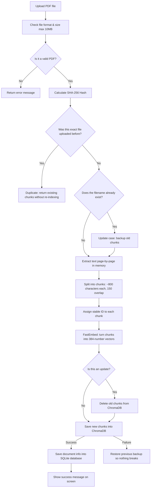
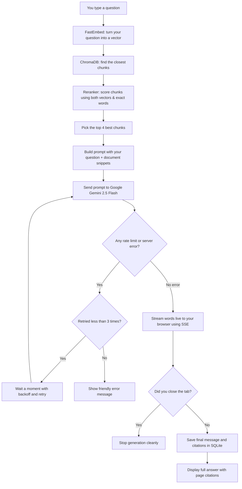

# Knowledge Assistant — RAG-Powered PDF Question Answering

[](https://fastapi.tiangolo.com)
[-000000.svg?style=flat&logo=next.js)](https://nextjs.org)
[](https://www.python.org)
[-FF6F00.svg?style=flat)](https://github.com/qdrant/fastembed)
[](https://www.trychroma.com)
[](https://ai.google.dev)
[](https://docs.pytest.org)

Knowledge Assistant is an AI project that lets you upload PDF documents and ask questions about them. 

Instead of guessing or making things up, the assistant uses **Retrieval-Augmented Generation (RAG)** to read your documents, find the exact parts that match your question, and give you clear answers with exact page numbers.

The project pairs a **FastAPI** (Python) backend with a clean **Next.js 16** (React 19) frontend. It creates text embeddings on your local machine using FastEmbed, saves them in a persistent ChromaDB vector database, and uses **Google Gemini 2.5 Flash** to write grounded answers in real-time streaming text.

---

## Table of Contents

- [1. Project Overview](#1-project-overview)
- [2. Key Features](#2-key-features)
- [3. AI Concepts Explained in Plain English](#3-ai-concepts-explained-in-plain-english)
- [4. How RAG Works (Workflows & Diagrams)](#4-how-rag-works-workflows--diagrams)
- [5. Tech Stack](#5-tech-stack)
- [6. Project Structure](#6-project-structure)
- [7. Setup & Installation](#7-setup--installation)
- [8. How to Use the App](#8-how-to-use-the-app)
- [9. API Reference](#9-api-reference)
- [10. Testing & Evaluation](#10-testing--evaluation)
- [11. Known Limitations](#11-known-limitations)
- [12. Security & Safety](#12-security--safety)
- [13. Future Improvements](#13-future-improvements)
- [14. What This Project Demonstrates](#14-what-this-project-demonstrates)
- [15. License](#15-license)

---

## 1. Project Overview

### What It Does
Knowledge Assistant helps you find information inside PDF files quickly. You upload a PDF—like an employee handbook, policy guide, or technical report—and then chat with it like you would with a person. The assistant answers your questions based only on the contents of the file, and tells you exactly which page each fact came from.

### The Problem It Solves
Normal AI chatbots have three big problems when used for real work:
1. **They hallucinate**: They can make up facts that sound very believable but are completely wrong.
2. **They don't know your files**: They cannot see your company's private documents or recent files unless you feed them directly.
3. **They don't show proof**: They give you an answer, but they don't show where they found the information.

Knowledge Assistant fixes these issues:
- It searches your uploaded files first, pulls out the exact paragraphs needed, and hands them to the AI model.
- The AI model is strictly instructed to only use the provided text and cite the source (e.g., `[Source: company_handbook.pdf, Page 3]`).
- If the answer is not in the document, it simply says: *"The uploaded documents do not provide enough information to answer this question."*

### Main Capabilities
- **Fast, in-memory PDF reading**: Reads text page-by-page directly in memory without saving the raw files on disk.
- **Smart text chunking**: Cuts long pages into ~800-character pieces with a 150-character overlap, without mixing text between different pages.
- **Free local embeddings**: Uses a compact embedding model (`BAAI/bge-small-en-v1.5`) running on your own computer. You do not need to pay for an external embedding API.
- **Persistent vector database**: Saves vectors in ChromaDB so your indexed documents remain ready to search even if you restart the server.
- **Reranking for better search results**: Combines semantic meaning (65%) with exact word matching (35%) so specific terms and numbers don't get missed.
- **Resilient AI connections**: Automatically retries if Google Gemini is busy (rate limits or 503 errors) using exponential backoff.
- **Live streaming chat**: Displays answers word-by-word as they are generated using Server-Sent Events (SSE).
- **Document management**: Detects duplicate uploads with SHA-256 hashes, cleanly updates existing files, and lets you delete documents with one click.
- **Built-in evaluation script**: Tests the system on 20 benchmark questions to measure search accuracy, citations, and refusal of unanswerable questions.

---

## 2. Key Features

| Feature | How It Works in This Project |
| :--- | :--- |
| **PDF Upload & Validation** | Checks the file format, makes sure it starts with the standard PDF header (`%PDF`), rejects files bigger than 10 MB, and extracts text page-by-page using PyPDF. |
| **Page-Aware Chunking** | Splits each page into chunks of roughly 800 characters with 150 characters of overlap. It never combines text from two different pages, keeping page numbers completely accurate. |
| **Stable Chunk IDs** | Gives every chunk a unique ID like `handbook_pdf_p2_c1` (filename, page 2, chunk 1), making lookups and updates clean and predictable. |
| **Local Text Embeddings** | Runs FastEmbed on your machine with `BAAI/bge-small-en-v1.5` to turn text into 384-number vectors without calling any external embedding API. |
| **ChromaDB Storage** | Stores all vectors on disk in `backend/data/chroma`. If ChromaDB is not installed, it automatically falls back to a simple file-backed vector store so the app still works. |
| **Hybrid Search & Reranking** | Finds candidate chunks using vector similarity, then boosts chunks that share exact important words with the question. This prevents rare terms and numbers from getting lost. |
| **Strictly Grounded Answers** | Sends the retrieved snippets to Google Gemini 2.5 Flash with strict rules: use only these excerpts, cite the page, and never make things up. |
| **Live Word-by-Word Streaming** | Streams the answer live to the frontend using Server-Sent Events (SSE), so you don't have to wait for the whole answer to finish before reading. |
| **Exact Source Citations** | The assistant adds citations directly into its answer, such as `[Source: handbook.pdf, Page 4]`. |
| **Duplicate File Detection** | Computes a SHA-256 hash for every file. If you upload the exact same PDF twice, it reuses the existing chunks instead of wasting time re-indexing. |
| **Safe Document Updates** | If you upload an edited PDF with the same filename, it replaces the old chunks with the new ones. If something fails, it restores your old version automatically. |
| **Easy Document Deletion** | Deleting a document removes its records from both SQLite and ChromaDB, so its content stops showing up in future search results immediately. |
| **Smart Rate-Limit Handling** | If Gemini returns a 429 (too many requests) or 503 (server busy), the backend waits and retries up to 3 times before giving up. |
| **Built-in Test Suite** | Includes 6 unit test suites and an evaluation script (`evaluate_rag.py`) to test search accuracy, citations, and answer quality. |

---

## 3. AI Concepts Explained in Plain English

Here is a quick look at the AI ideas used in this project, and how they compare to ideas that are *not* part of this project:

```
┌────────────────────────────────────────────────────────────────────────┐
│                        AI Concepts in this Project                     │
├───────────────────────────────────┬────────────────────────────────────┤
│         Used in This App          │    NOT Used / Related Only         │
├───────────────────────────────────┼────────────────────────────────────┤
│ • Retrieval-Augmented Generation  │ • Training your own AI model       │
│ • Local Text Embeddings           │ • Fine-tuning model weights        │
│ • Vector Similarity Search        │ • Reinforcement learning (RLHF)    │
│ • Hybrid Reranking (Vector + Words)│ • Reading scanned images (OCR)    │
│ • Prompt Grounding & Citations    │ • Complex multi-agent loops        │
│ • Streaming AI Responses          │ • Graph-based RAG (GraphRAG)       │
│ • Automated RAG Evaluation        │ • Cross-encoder neural rerankers   │
└───────────────────────────────────┴────────────────────────────────────┘
```

### Detailed Explanations

#### 1. Artificial Intelligence (AI) and Large Language Models (LLMs)
- **What it means**: AI refers to computer programs that can perform tasks that usually require human intelligence. Large Language Models (like GPT-4 or Gemini) are giant neural networks trained on billions of pages of text to predict the next words in a conversation.
- **In this project**: We **do not train or fine-tune our own model**. That would take hundreds of expensive graphics cards. Instead, we use Google's ready-to-use `gemini-2.5-flash` model through an API to read our text and write answers.

#### 2. Generative AI
- **What it means**: AI that can create new content (like writing sentences, code, or summaries) based on what you ask.
- **In this project**: It writes natural, human-like answers to your questions based on what it finds in your PDF.

#### 3. Retrieval-Augmented Generation (RAG)
- **What it means**: Instead of asking the AI model to remember everything from memory, you first search your own documents (Retrieval), pick out the most useful paragraphs, and paste them into the prompt (Augmented). Then, the AI uses those paragraphs to write the answer (Generation).
- **In this project**: This is the core workflow: PDF text $\rightarrow$ search relevant pieces $\rightarrow$ feed pieces to Gemini $\rightarrow$ return cited answer.

#### 4. Document Ingestion and Preprocessing
- **What it means**: Taking raw files, checking that they are safe and valid, and extracting clean text out of them.
- **In this project**: The code inspects the PDF bytes, verifies the file is not damaged or password-locked, cleans up the filename, and extracts text page-by-page.

#### 5. Text Chunking and Metadata
- **What it means**: AI models and embedding tools cannot read an entire 100-page book at once. Chunking means breaking the text down into small, digestible pieces (like 1 to 2 paragraphs each). Metadata is extra information attached to each piece, such as which file and page it came from.
- **In this project**: We cut text into pieces of about 800 characters with 150 characters of overlap. We never blend text across page lines, and we tag every chunk with its file name, page number, and chunk position.

#### 6. Text Embeddings and Semantic Similarity
- **What it means**: Computers do not understand words; they understand numbers. An embedding model converts a piece of text into a list of numbers (a vector). Sentences with similar meanings end up with similar numbers, even if they use completely different words (for example, "how much does it cost?" and "what is the price?" will have very close numbers).
- **In this project**: We use a local model (`bge-small-en-v1.5`) that turns every chunk into a list of 384 numbers. We compare two pieces of text using **cosine similarity** to see how close their meanings are.

#### 7. Vector Databases
- **What it means**: A regular database (like MySQL or SQLite) is great for looking up exact text or numbers. A vector database is built specifically to store lists of numbers and quickly find which ones are closest to your question.
- **In this project**: We use ChromaDB. It saves all the chunk vectors into a folder on your drive (`backend/data/chroma`) so you can search them at any time.

#### 8. Hybrid Retrieval and Reranking
- **What it means**: Vector search is great for finding general meanings, but it can sometimes overlook exact words, technical model numbers, or codes. Hybrid search combines vector search with classic keyword search so you don't miss exact terms.
- **In this project**: The app retrieves the top candidate chunks, checks for exact matching words, and calculates a combined score (65% vector similarity + 35% word match). The chunks with the highest combined score are selected.

#### 9. Prompt Engineering and Grounded Generation
- **What it means**: Prompt engineering means writing clear, firm instructions for the AI model. Grounded generation means forcing the model to stay strictly inside the facts you gave it, rather than pulling answers out of thin air.
- **In this project**: Our prompt tells Gemini: *"Answer the user's question using ONLY the excerpts below. For every claim, add a citation with the page number. If the answer is not in the text, say you don't know."*

#### 10. Source Citations
- **What it means**: Giving credit to the exact source page so a human can easily verify the AI's claims.
- **In this project**: The model is instructed to write `[Source: filename.pdf, Page 2]` after every answer.

#### 11. Streaming Responses
- **What it means**: Instead of waiting 5 to 10 seconds for the model to finish writing its entire answer, the server sends each word to your screen as soon as it is generated.
- **In this project**: We use Server-Sent Events (SSE) so words appear on your screen in real time. If you close your browser tab, the server stops generating immediately to save resources.

#### 12. Rate Limits and Retries with Backoff
- **What it means**: If you send too many requests to an AI service, it will temporarily block you with an error (HTTP 429). Exponential backoff means waiting a short time (e.g., 1 second), then twice as long (2 seconds), then 4 seconds, before trying again.
- **In this project**: Our backend automatically handles rate limits and retries up to 3 times before showing an error.

#### 13. RAG Evaluation
- **What it means**: Testing how well your RAG system actually works with numbers, rather than just guessing.
- **In this project**: We measure 5 clear metrics:
  - **Recall**: Did we find the right page?
  - **MRR (Ranking quality)**: Was the right page at the top of the search results?
  - **Citation Correctness**: Did the AI cite real, relevant pages?
  - **Refusal Accuracy**: Did the AI correctly say "I don't know" when asked about something not in the PDF?
  - **Fact Coverage**: Did the AI mention the key facts in its answer?

---

## 4. How RAG Works (Workflows & Diagrams)

The system works in two separate steps:
1. **Ingestion (Saving the PDF)**
2. **Retrieval and Answering (Answering your question)**

---

### Step 1: Ingestion & Indexing Workflow

When you upload a PDF file, this is what happens behind the scenes:



---

### Step 2: Retrieval & Question Answering Workflow

When you type a question in the chat, this is what happens:



---

## 5. Tech Stack

Every technology listed here comes directly from the project's configuration files:

### Backend
- **Language**: Python 3.10+
- **Web Framework**: [FastAPI](https://fastapi.tiangolo.com) (version `>=0.115.0`)
- **Web Server**: [Uvicorn](https://www.uvicorn.org) (version `>=0.30.0`)
- **Data Validation**: [Pydantic v2](https://docs.pydantic.dev) (version `>=2.9.0`)
- **Database & ORM**: [SQLAlchemy](https://www.sqlalchemy.org) (`>=2.0.30`) with an SQLite database (`chat.db`)
- **PDF Extraction**: [PyPDF](https://pypdf.readthedocs.io) (version `>=4.0.0`)
- **Embeddings**: [FastEmbed](https://github.com/qdrant/fastembed) (version `>=0.4.0`)
  - **Default model**: `BAAI/bge-small-en-v1.5` (produces 384-dimensional vectors locally)
- **Vector Store**: [ChromaDB](https://www.trychroma.com) (version `>=0.5.0`)
- **AI Model Provider**: [Google GenAI SDK](https://github.com/googleapis/python-genai) (`google-genai>=0.1.1`)
  - **Default model**: `gemini-2.5-flash`
- **Testing**: [Pytest](https://docs.pytest.org) (`>=8.0.0`) and [HTTPX](https://www.python-httpx.org) (`>=0.27.0`)

### Frontend
- **Framework**: [Next.js 16.4.2](https://nextjs.org) (using App Router)
- **UI Library**: [React 19.3.0](https://react.dev)
- **Styling**: [Tailwind CSS v4](https://tailwindcss.com)
- **Language**: [TypeScript 5](https://www.typescriptlang.org)
- **Communication**: Server-Sent Events (SSE) for word-by-word streaming

---

## 6. Project Structure

Here is a simplified map of the folders and files in the project:

```
knowledge_assistant/
├── README.md                           # This guide
├── AGENTS.md                           # Rules for automated agents
│
├── backend/                            # Python FastAPI Backend
│   ├── main.py                         # Starts the server & registers routes
│   ├── requirements.txt                # Python packages needed
│   ├── .env                            # Your API keys and configuration
│   │
│   ├── app/
│   │   ├── config.py                   # Settings (model names, chunk sizes)
│   │   ├── db/
│   │   │   ├── models.py               # Database tables: Documents, Chats, Messages
│   │   │   └── session.py              # SQLite database connection
│   │   ├── providers/
│   │   │   ├── gemini.py               # Gemini connection with retries & error safety
│   │   │   └── embeddings/mock_provider.py # Fake embedding tool for offline tests
│   │   ├── routes/
│   │   │   ├── documents.py            # Upload, index, search, and delete endpoints
│   │   │   └── conversations.py        # Chat sessions and streaming endpoints
│   │   ├── schemas/                    # Pydantic models for incoming & outgoing data
│   │   ├── services/
│   │   │   ├── pdf_service.py          # Extracts text from PDF bytes in memory
│   │   │   ├── chunking_service.py     # Cuts pages into overlapping chunks
│   │   │   ├── embedding_service.py    # Converts text to vectors with FastEmbed
│   │   │   ├── search_service.py       # Vector search, reranking, and updates
│   │   │   └── rag_service.py          # Builds prompts and manages answers
│   │   └── vector_store/
│   │       ├── chroma_store.py         # ChromaDB vector store
│   │       ├── memory_store.py         # Lightweight fallback in-memory store
│   │       └── factory.py              # Picks ChromaDB or in-memory automatically
│   │
│   ├── data/
│   │   ├── chat.db                     # SQLite database file
│   │   ├── chroma/                     # ChromaDB vectors saved on disk
│   │   ├── eval_dataset.json           # 20 test questions for benchmark evaluation
│   │   └── sample_documents/           # Test PDF files
│   │
│   ├── scripts/
│   │   ├── evaluate_rag.py             # Evaluation script for measuring accuracy
│   │   └── generate_sample_pdf.py      # Makes a sample company handbook PDF
│   │
│   └── tests/                          # 6 automated test files
│
└── frontend/                           # Next.js 16 Web Application
    ├── package.json                    # Frontend dependencies
    ├── src/
    │   ├── app/
    │   │   ├── page.tsx                # Main chat page
    │   │   └── documents/page.tsx      # Document upload & management page
    │   ├── features/
    │   │   ├── chat/                   # Chat UI, message bubbles, streaming hook
    │   │   └── documents/              # File upload zone & document list with delete
    │   └── components/ui/              # Buttons, inputs, and small UI elements
```

---

## 7. Setup & Installation

### Requirements
- **Python**: Version `3.10` or newer.
- **Node.js**: Version `18.17` or newer (version `20.x` recommended).
- **Google Gemini API Key**: Get a free API key from [Google AI Studio](https://aistudio.google.com/).

---

### Step 1: Open the Project Directory

```powershell
cd F:\Python\knowledge_assistant
```

---

### Step 2: Set Up the Backend

1. Go to the `backend` folder and create a virtual environment:

   *On Windows (PowerShell):*
   ```powershell
   cd backend
   python -m venv .venv
   .\.venv\Scripts\Activate.ps1
   ```

   *On Windows (Command Prompt):*
   ```cmd
   cd backend
   python -m venv .venv
   .\.venv\Scripts\activate.bat
   ```

   *On Linux / Mac:*
   ```bash
   cd backend
   python3 -m venv .venv
   source .venv/bin/activate
   ```

2. Install the required Python packages:
   ```powershell
   pip install -r requirements.txt
   ```

3. Create your `.env` configuration file in the `backend/` folder:
   Create a file named `.env` inside `backend/` with these lines:
   ```env
   AI_PROVIDER=gemini
   GEMINI_API_KEY=your_actual_gemini_api_key_here
   GEMINI_MODEL=gemini-2.5-flash
   ```

---

### Step 3: Set Up the Frontend

1. Open a **second terminal window** and navigate to the `frontend` folder:
   ```powershell
   cd F:\Python\knowledge_assistant\frontend
   ```

2. Install dependencies:
   ```powershell
   npm install
   ```

3. Create your `.env.local` configuration file:
   Make a file named `.env.local` inside `frontend/` with this line:
   ```env
   NEXT_PUBLIC_API_BASE_URL=http://127.0.0.1:8000
   ```

---

### Step 4: Run the Application

1. **Start the Backend** (in your backend terminal with the virtual environment activated):
   ```powershell
   uvicorn main:app --reload --host 127.0.0.1 --port 8000
   ```
   The backend API is now running at `http://127.0.0.1:8000`. You can view the automatic Swagger API documentation at `http://127.0.0.1:8000/docs`.

2. **Start the Frontend** (in your frontend terminal):
   ```powershell
   npm run dev
   ```
   Open your browser and visit: **`http://localhost:3000`**.

---

## 8. How to Use the App

### 1. Upload a PDF
1. Go to `http://localhost:3000/documents`.
2. Drag and drop your PDF into the upload box (or click to browse).
3. The app will inspect the file, extract the text, create chunks, embed them with FastEmbed, and save them in ChromaDB.
4. When finished, you will see the total number of pages and chunks that were indexed.

### 2. What Happens if You Upload the Same File Again?
- **Identical content**: If you upload the exact same file twice, the app checks the SHA-256 hash, skips the duplicate work, and tells you it is already indexed.
- **Updated version**: If you edit the PDF and upload it with the same filename, the app replaces the old chunks with the new ones so you never get outdated search results.

### 3. Ask Questions
1. Go back to the main chat page at `http://localhost:3000`.
2. Ask any question about your PDF (e.g., *"What are the office hours?"* or *"What is the policy for sick days?"*).
3. The assistant will search the document, find the matching pages, and stream an answer directly to your screen.

### 4. Read Citations
Every grounded answer includes citations like:
> `[Source: company_handbook.pdf, Page 4]`

If your question is about something not mentioned in the PDF, the assistant will tell you clearly:
> *"The uploaded documents do not provide enough information to answer this question."*

### 5. Delete Documents
1. On the `http://localhost:3000/documents` page, look at the **Knowledge Base Documents** list at the bottom.
2. Click the **Delete** button next to any file.
3. Confirm the prompt. The file's records are deleted from both SQLite and ChromaDB immediately. Future questions will no longer use content from that file.

---

## 9. API Reference

You can test every endpoint directly using the interactive Swagger docs at `http://127.0.0.1:8000/docs`.

### Document Endpoints (`/api/documents`)

| Method | URL | What It Does |
| :--- | :--- | :--- |
| `POST` | `/api/documents/upload` | Uploads a PDF, chunks it, generates embeddings, and saves it in ChromaDB. |
| `POST` | `/api/documents/index` | Direct indexing endpoint for a PDF file. |
| `POST` | `/api/documents/search` | Performs a semantic search for a query and returns top matching chunks. |
| `GET` | `/api/documents/search` | Browser-friendly search using query parameters (`?q=your_query&top_k=4`). |
| `POST` | `/api/documents/ask` | Non-streaming question-answering endpoint. Returns the answer and sources. |
| `GET` | `/api/documents` | Returns a list of all uploaded documents with page and chunk counts. |
| `GET` | `/api/documents/{id}` | Gets details for a single document by its ID. |
| `DELETE` | `/api/documents/{id}` | Deletes a document from both SQLite and ChromaDB. |
| `GET` | `/api/documents/collection-stats` | Shows how many chunks are currently saved in the vector database. |
| `DELETE` | `/api/documents/collection` | Clears all chunks from the vector database. |

### Chat Endpoints (`/api/conversations`)

| Method | URL | What It Does |
| :--- | :--- | :--- |
| `POST` | `/api/conversations` | Starts a new chat conversation. |
| `GET` | `/api/conversations` | Lists all previous conversations. |
| `GET` | `/api/conversations/{id}/messages` | Gets all messages in a conversation. |
| `POST` | `/api/conversations/{id}/messages` | Sends a message and receives a full reply. |
| `POST` | `/api/conversations/{id}/messages/stream` | **Streaming endpoint**: Streams the AI reply word-by-word using SSE. |

---

### Example Requests & Responses

#### 1. Search Your Documents
```http
POST /api/documents/search HTTP/1.1
Content-Type: application/json

{
  "query": "core collaboration hours",
  "top_k": 1
}
```

*Response (`200 OK`):*
```json
{
  "query": "core collaboration hours",
  "total_results": 1,
  "model": "BAAI/bge-small-en-v1.5",
  "results": [
    {
      "chunk_id": "handbook_pdf_p2_c1",
      "text": "Core collaboration hours are 10:00 AM to 3:00 PM PST. All employees must be reachable on Slack during this time.",
      "filename": "handbook.pdf",
      "page_number": 2,
      "chunk_index": 1,
      "similarity_score": 0.8421,
      "distance": 0.1579
    }
  ]
}
```

#### 2. Ask a Question via API
```http
POST /api/documents/ask HTTP/1.1
Content-Type: application/json

{
  "question": "What are the core hours?",
  "top_k": 3
}
```

*Response (`200 OK`):*
```json
{
  "question": "What are the core hours?",
  "answer": "Core collaboration hours are 10:00 AM to 3:00 PM PST [Source: handbook.pdf, Page 2].",
  "sources": [
    {
      "chunk_id": "handbook_pdf_p2_c1",
      "text": "Core collaboration hours are 10:00 AM to 3:00 PM PST...",
      "filename": "handbook.pdf",
      "page_number": 2,
      "similarity_score": 0.8421
    }
  ]
}
```

---

## 10. Testing & Evaluation

### The Test Dataset
The project includes a benchmark dataset at `backend/data/eval_dataset.json` with 20 questions tested against a sample employee handbook:
1. **Direct Questions (10)**: Questions answered on a single page (e.g. *"What is the 401(k) match?"*).
2. **Multi-Section Questions (5)**: Questions comparing rules across different pages (e.g. vacation days vs. sick leave).
3. **Unanswerable Questions (5)**: Questions about things not in the handbook (e.g. pet insurance or cafeteria menu) to test if the model resists hallucinating.

---

### Evaluation Metrics Explained Simply

- **Recall@K**: Did the search find the correct page in the top K chunks? (Yes or No).
- **MRR (Mean Reciprocal Rank)**: How high on the list was the right page? If it's rank #1, score is 1.0. If rank #2, score is 0.5.
- **Citation Correctness**: Did the AI cite the real, correct page number?
- **Refusal Accuracy**: When asked an unanswerable question, did the AI say "I don't know" instead of inventing an answer?
- **Fact Coverage**: Did the AI mention all the essential numbers and facts from the answer checklist?

---

### How to Run Tests

#### 1. Run the Fast Unit Test Suite
Runs all 6 unit tests offline without calling the Gemini API:

```powershell
cd F:\Python\knowledge_assistant\backend
.\.venv\Scripts\Activate.ps1
python -m pytest tests/ -v
```

#### 2. Run the Offline Evaluation (Free, No API Key Needed)
Uses a deterministic mock LLM to test retrieval and metrics quickly:

```powershell
cd F:\Python\knowledge_assistant\backend
.\.venv\Scripts\Activate.ps1
python scripts/evaluate_rag.py --top-k 4 --diagnostics
```

#### 3. Run the Live Pipeline Evaluation (Uses Real Gemini)
Tests the full system using live Gemini 2.5 Flash, ChromaDB, and FastEmbed:

```powershell
cd F:\Python\knowledge_assistant\backend
.\.venv\Scripts\Activate.ps1
python scripts/evaluate_rag.py --real-pipeline --limit 3
```

> **Note**: The unit tests use offline mocks so they pass reliably every time. The live evaluation calls the real Google Gemini API, so results depend on your API quota and network connection.

---

## 11. Known Limitations

1. **Free Gemini Rate Limits**: Google's free-tier API has limits on requests per minute. If you send too many questions too fast, you might hit a 429 error. The app retries automatically, but very fast repetitive questions can temporarily exceed your quota.
2. **Scanned PDFs**: The app extracts digital text using PyPDF. If you upload a scanned image of a page (a photocopy with no selectable text), it cannot extract text because Optical Character Recognition (OCR) is not yet included.
3. **Single Computer Storage**: SQLite and ChromaDB store files locally on your computer. They are not set up for large multi-server cloud clusters.
4. **Complex Tables**: While normal tables work fine, complex spreadsheets with nested rows may have their text extracted in reading order rather than table cells.

---

## 12. Security & Safety

### Protections Already Built In
- **API Key Protection**: Your Gemini API key stays inside `backend/.env`. It is never sent to the browser, and any accidental keys in error logs are automatically redacted.
- **File Validation**: The backend checks PDF magic bytes (`%PDF`) and rejects files over 10 MB before they use up memory.
- **Path Protection**: Uploaded filenames are stripped of dangerous characters to prevent directory traversal attacks.
- **Clean Errors**: If something crashes, the server sends back simple error messages instead of leaking private server paths or raw stack traces.
- **Safe Disconnects**: If a user closes the browser during a response stream, the backend cancels the task cleanly.

### Suggested Improvements for Production
- Add user login (JWT/OAuth) so different users have private document folders.
- Add an antivirus scanner for uploaded files.
- Add an extra prompt-guard filter to catch adversarial prompt-injection attempts.

---

## 13. Future Improvements

- **OCR Support**: Add Tesseract OCR to read scanned PDF documents and photos.
- **Multi-Modal Support**: Let the AI read diagrams and charts directly using Gemini's vision features.
- **Reranker Models**: Add a cross-encoder model (like `bge-reranker-large`) for even higher search accuracy.
- **Cloud Vector Databases**: Add support for Qdrant, Milvus, or PostgreSQL with pgvector for larger cloud deployments.
- **Query Rewriting**: Automatically improve vague user questions before running the search.

---

## 14. What This Project Demonstrates

This project shows practical hands-on experience in modern AI software engineering:
1. Building a full RAG system from scratch using Python and TypeScript.
2. Understanding vector embeddings, chunking strategies, and cosine similarity.
3. Combining vector search with keyword matching (hybrid reranking).
4. Writing solid error handling with exponential backoff for external AI APIs.
5. Measuring AI performance with real evaluation metrics (Recall, MRR, Refusal).
6. Building modern full-stack web apps with FastAPI, Next.js 16, and Server-Sent Events.

---

## 15. License

A license has not yet been specified for this project. All rights are reserved by the repository owner.
